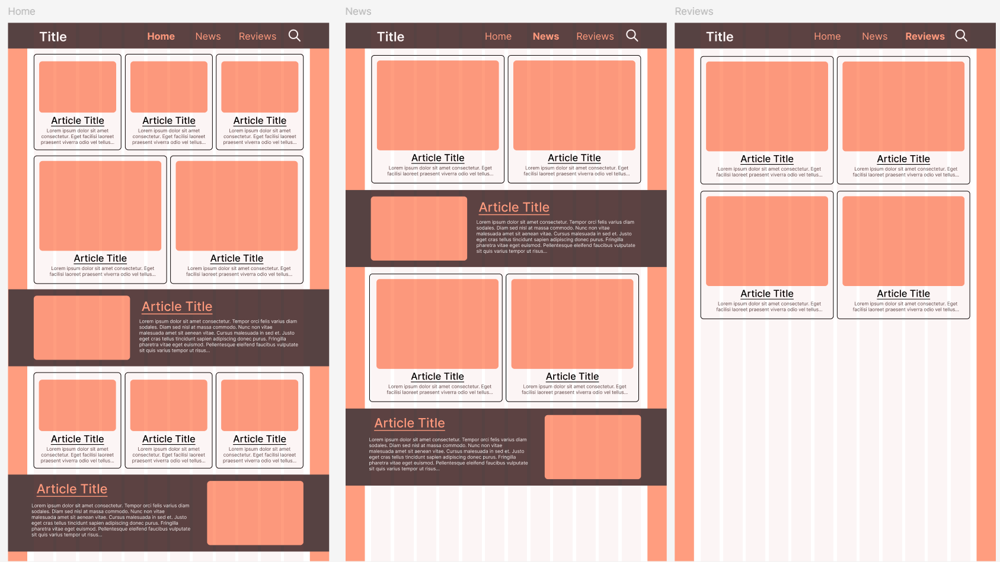

# WebTechArticles

Project for Web Techniques involving an article-based site, it has Create, Read, Update, Delete functionality  
Theme: it’s a games website  
Target Audience: people who play/develop games

## Notes

I used a simple card-based layout (with a 12-column grid), the number of articles on each row of the home page is different to keep the design more interesting and less repetitive, articles that go across the borders are the most important headlines and I want them to stand out

## Functionality

|Feature / Function|Does it work|
|-|-|
|Navigate between pages using router|yes|
|Add new article|yes|
|Update an article|yes|
|Delete an article|yes|
|Read an article|yes* as a card|
|Article search|yes|
|Form Validation|yes|
|Responsive Design|yes|
|'Not found' page|yes|
|Navbar|yes|

## Pages

The home page displays both News and Reviews, on the navbar there are links to similar pages but for only News and only Reviews which use a filtered array. There is also a search page where you can search for articles by name or category and you can also create, edit and delete articles. When you make changes to an article it will stay consistent across all the pages, there is also a ‘not found’ page for if you enter an invalid address where you can use the navbar to get back to the other pages

## Wireframes
